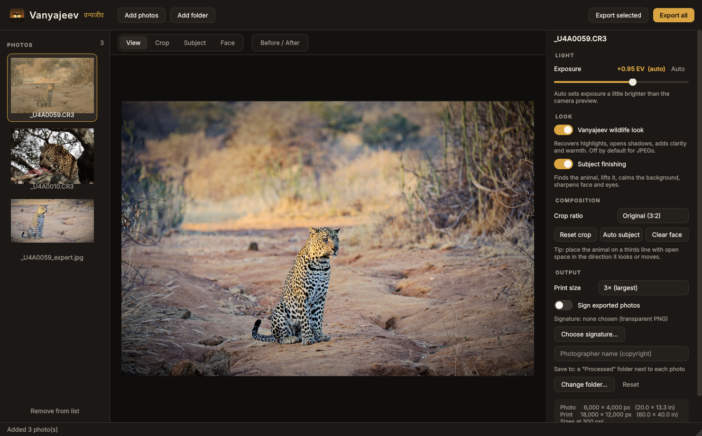

# Vanyajeev · वन्यजीव

**Wildlife RAW & JPEG developer for Windows.** *Vanyajeev* is Sanskrit/Hindi for "wildlife".



Drop in your photos, see the before/after, set exposure, crop, mark the animal and its face, and export finished JPEGs, print masters and signed copies. It uses the same verified pipeline as [`raw-to-jpeg`](../HOW_TO_RUN.md), so results match it exactly.

## Install

| Option | How |
| --- | --- |
| **Installer** | Download `VanyajeevSetup-<version>.exe` from the repo's **Releases** (or the latest build under **Actions → Vanyajeev Windows build → Artifacts**) and run it. Windows may show "Windows protected your PC" because the installer isn't code-signed yet: click **More info → Run anyway**. |
| **Portable** | Unzip `Vanyajeev-<version>-portable.zip` anywhere and run `Vanyajeev.exe`. |
| **Microsoft Store** | Coming soon (free). Store builds are signed by Microsoft, so there's no warning. |

Windows 10 (1809) or later, 64-bit. 16 GB RAM recommended for 3× print masters of full-size RAWs.

## Use it

1. **Add photos**: click *Add photos* / *Add folder*, or drag files onto the window. RAW (CR3, CR2, NEF, ARW, RAF, DNG, ORF, RW2 and more) and JPEG/TIFF/PNG.
2. **Check the look**: the wildlife look and subject finishing are on for RAW files. Toggle *Before / After* (B) and drag the divider to compare.
3. **Adjust if needed**:
   - **Exposure**: slider; *Auto* sets it slightly brighter than the camera preview.
   - **Crop (C)**: drag on the full frame; the thirds grid helps place the animal with space in front of it.
   - **Subject (S)**: the gold tint shows the detected animal; drag a box if it picked the wrong thing.
   - **Face (F)**: click between the eyes for extra clarity and an eye lift.
4. **Output**: choose the print size (off / 2× / 3×), optionally a signature PNG and your name for the copyright field.
5. **Export selected** (Ctrl+E) or **Export all**. Files go to a `Processed` folder next to each photo unless you choose another folder:
   - `<name>_vanyajeev.jpg`: finished photo
   - `<name>_vanyajeev_print3x.jpg`: print master
   - `signed\…`: signed copies

Any transparent PNG works as a signature; Vanyajeev makes black and white versions and picks whichever reads better in each photo's corner.

## Build from source

```
cd vanyajeev
python -m pip install -r requirements.txt
python main.py                 # run the app
python main.py --selftest      # headless end-to-end check
pip install pyinstaller
pyinstaller --noconfirm packaging/vanyajeev.spec      # -> dist\Vanyajeev\Vanyajeev.exe
```

Every push to `master` that touches the app builds it on GitHub (`.github/workflows/vanyajeev-windows.yml`): it runs the self-test, builds with PyInstaller, runs the self-test again on the packaged exe, and produces the installer, a portable zip and an MSIX. Pushing a tag `vanyajeev-v1.0.1` creates a GitHub Release with those files.

## Publish to the Microsoft Store (free)

See [STORE.md](STORE.md).

## License

MIT, see [LICENSE](../LICENSE).
